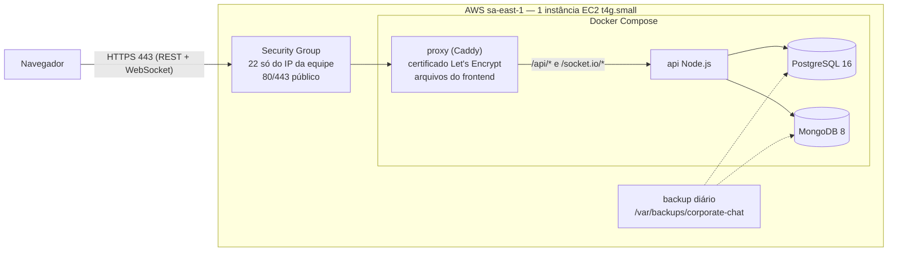

# Corporate Chat — DEP-01 | Implantação na AWS

**Objetivo:** deixar pronto, documentado e reproduzível, o caminho para publicar o Corporate Chat na AWS usando somente os créditos do plano gratuito, **sem mensalidade obrigatória** durante o período de avaliação.

> **Situação:** preparado para decisão da equipe. Nenhum recurso foi criado na AWS. A execução depende de a equipe (e o orientador, pendência **P01 — Hospedagem**) decidir publicar.

## 1. Entregas

| Entrega | Documento | O que fica pronto |
|---|---|---|
| DEP-01.1 — Conta e servidor | [DEP-01-1-CONTA-E-SERVIDOR.md](DEP-01-1-CONTA-E-SERVIDOR.md) | Conta no plano Free protegida, alerta de gastos, instância EC2 preparada automaticamente (Docker, firewall, SSH só com chave, swap, atualizações de segurança) |
| DEP-01.2 — Publicação | DEP-01-2-PUBLICACAO.md (próxima entrega) | Aplicação publicada com HTTPS automático, frontend e API no mesmo endereço, administrador inicial criado sem senha conhecida |
| DEP-01.3 — Segurança e recuperação | DEP-01-3-SEGURANCA-E-RECUPERACAO.md (próxima entrega) | Verificação de segurança automatizada, backup diário, ensaio de restauração e plano de encerramento |

## 2. Arquitetura

- **Um único servidor** com tudo em contêineres: é o arranjo mais barato e o mesmo já validado no BE-18 (`docker-compose.deploy.yml`).
- **Bancos sem porta pública:** PostgreSQL e MongoDB só são acessíveis pela rede interna do Docker.
- **Mesmo endereço para frontend, API e Socket.IO:** evita problemas de CORS e de cookies entre domínios.

## 3. Decisões tomadas e pendentes

| Tema | Decisão proposta | Situação |
|---|---|---|
| Publicar ou demonstrar local | — | **Pendente (P01, orientador)** |
| Conta | Conta nova no **plano Free** (créditos de até US$ 200; não gera cobrança) | Equipe decide quem será o titular |
| Região | **São Paulo (sa-east-1)** | Definida |
| Servidor | **t4g.small** (2 vCPU ARM, 2 GB) + 20 GB gp3 + IP elástico | Proposta |
| Endereço | **sslip.io** gratuito (ex.: `https://15-228-10-20.sslip.io`) ou domínio próprio | Equipe decide |
| HTTPS | Caddy com Let's Encrypt automático | Proposta |

## 4. Custo estimado (consumido dos créditos, não cobrado no plano Free)

Preços sob demanda em sa-east-1 (Linux), 730 h/mês. **Confirme no [AWS Pricing Calculator](https://calculator.aws/) antes de criar.**

| Item | Base de cálculo | US$/mês |
|---|---|---|
| EC2 t4g.small | US$ 0,0268/h | ≈ 19,60 |
| EBS gp3 20 GB | ≈ US$ 0,152/GB-mês | ≈ 3,05 |
| IPv4 público (IP elástico) | US$ 0,005/h | ≈ 3,65 |
| Tráfego de saída | até 100 GB/mês gratuitos | 0,00 |
| **Total** | | **≈ 26,30** |

- Com **US$ 100** de créditos: cerca de **3,5 meses**. Com **US$ 200**: cobre os **6 meses** do plano.
- Alternativa x86: t3.small (US$ 0,0336/h) eleva o total para ≈ US$ 31/mês.
- **Desligar a instância** quando não estiver em uso economiza o item EC2 (o disco e o IP continuam sendo cobrados dos créditos).

### Regras do plano Free que a equipe precisa conhecer

- Contas criadas a partir de 15/07/2025 recebem US$ 100 no cadastro e até mais US$ 100 por atividades guiadas.
- No plano Free **não há cobrança**: a conta é **encerrada automaticamente** após 6 meses ou quando os créditos acabam (o que vier primeiro). **Antes disso, baixe os backups** (DEP-01.3, seção 6).
- Só passa a haver cobrança se alguém **migrar para o plano pago** (Paid plan). Nenhum passo deste guia exige isso.

## 5. Arquivos

| Arquivo | Uso |
|---|---|
| `deploy/aws/cloud-init.yaml` | "User data" da instância: baixa o projeto e prepara o servidor |
| `deploy/aws/bootstrap-servidor.sh` | Preparação do servidor (Docker, firewall, SSH, swap, atualizações) |
| `docker-compose.deploy.yml` | Bancos e API (BE-18) |
| `docker-compose.aws.yml` | Acrescenta o proxy HTTPS com o frontend (DEP-01.2) |
| `deploy/aws/Caddyfile`, `deploy/aws/proxy.Dockerfile` | Proxy HTTPS e build do frontend (DEP-01.2) |
| `deploy/scripts/publicar.sh` | Publica ou atualiza a aplicação (DEP-01.2) |
| `deploy/scripts/backup.sh`, `restaurar.sh`, `verificar-seguranca.sh` | Backup, restauração e verificação (DEP-01.3) |

## 6. Ordem de execução

1. Orientador confirma a necessidade de publicação (P01).
2. DEP-01.1 → DEP-01.2 → DEP-01.3, preenchendo a tabela de evidências de cada documento.
3. Registrar no diário de bordo o endereço publicado e as evidências.
4. Ao final da avaliação, seguir o **encerramento** (DEP-01.3, seção 7) para não consumir créditos sem necessidade.
